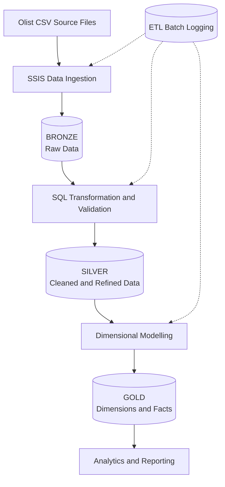
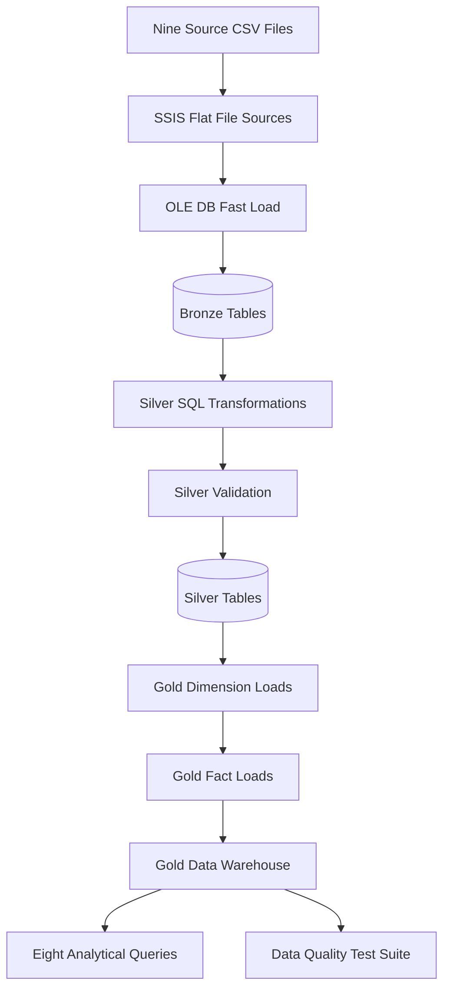
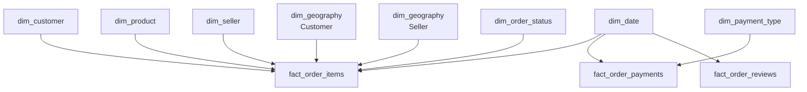
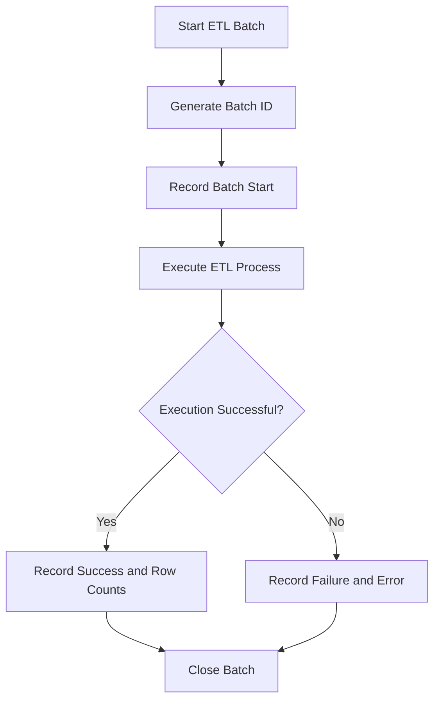

# Olist E-Commerce Data Warehouse | SSIS Medallion Architecture

## 1. Project Overview

This project implements a data warehouse using the Brazilian Olist e-commerce dataset. It demonstrates how raw transactional data can be extracted, loaded, cleaned, validated and transformed into an analytical data warehouse using Microsoft SQL Server, SQL Server Integration Services (SSIS) and T-SQL.

The solution follows the **Medallion Architecture**, separating data processing into Bronze, Silver and Gold layers, with an additional ETL layer for batch logging and process monitoring.

## 2. Technology Stack

- Microsoft SQL Server
- SQL Server Management Studio (SSMS)
- SQL Server Integration Services (SSIS)
- Visual Studio with SQL Server Data Tools
- Transact-SQL (T-SQL)
- Git and GitHub
- Mermaid for architecture and process documentation

## 3. Architecture

The solution uses four database schemas:

| Layer | Schema | Purpose |
|---|---|---|
| Bronze | `bronze` | Stores raw data loaded from source CSV files. |
| Silver | `silver` | Holds cleaned, standardised and refined data. |
| Gold | `gold` | Contains analytical dimensions and fact tables. |
| ETL | `etl` | Tracks ETL batch execution, status, row counts and errors. |

### 3.1 Medallion Architecture Diagram



### 3.2 Data Flow

1. Source CSV files are loaded into the Bronze layer through SSIS.
2. Silver processing cleans and standardises data. Geolocation transformation and customer/order validation are implemented in SQL.
3. Gold dimension and fact tables are populated using SQL transformation scripts.
4. ETL stored procedures record batch execution details and outcomes.
5. Gold tables support business analytics and reporting.

### 3.3 Data Processing Flow



## 4. Source Dataset

The project uses the Olist Brazilian E-Commerce Public Dataset.

Nine source CSV files are used:

- Customers
- Geolocation
- Order items
- Order payments
- Order reviews
- Orders
- Products
- Sellers
- Product category translation

The original CSV files are excluded from Git version control because of their size. Obtain the dataset separately and configure the SSIS project parameter `source_folder` to point to the directory containing the nine CSV files.

## 5. Bronze Layer

The Bronze layer stores source data in SQL Server with additional ETL metadata.

SSIS performs the data loading using Data Flow Tasks and OLE DB Fast Load destinations.

Each load includes metadata such as:

- `dwh_load_ts`
- `dwh_source_file`
- `dwh_batch_id`

### 5.1 Validated Bronze Record Counts

| Source table | Records |
|---|---:|
| Customers | 99,441 |
| Geolocation | 1,000,163 |
| Order items | 112,650 |
| Order payments | 103,886 |
| Order reviews | 99,224 |
| Orders | 99,441 |
| Products | 32,951 |
| Sellers | 3,095 |
| Category translation | 71 |
| **Total** | **1,550,922** |

## 6. Silver Layer

The Silver layer prepares data for downstream analytical processing.

Implemented transformations include:

- Standardisation of postal codes, city names and state values.
- Conversion and validation of latitude and longitude values.
- Removal of duplicate geolocation records.
- Review deduplication using `review_id` as the business key.
- Customer and order data validation.

### 6.1 Geolocation Transformation

The geolocation transformation:

- Aggregates location information by postal code.
- Applies Brazilian geographic coordinate boundaries.
- Produces one refined record per postal code.
- Preserves records with unavailable coordinates as NULL rather than treating invalid coordinates as valid locations.

**Validated Silver geolocation count: 19,015 records.**

Four postal codes have NULL coordinates following geographic validation.

### 6.2 Review Deduplication

The original Bronze review data contains 99,224 records. Silver processing reduces this to 98,410 unique review IDs.

The deduplication process retains one record per review ID using the latest available review-answer timestamp, with a deterministic tie-breaker.

See `sql/silver/README.md` for script details.

## 7. Gold Layer

The Gold layer contains dimensional and fact tables designed for analytical queries.

### 7.1 Dimensions

| Dimension | Records |
|---|---:|
| `gold.dim_customer` | 96,352 |
| `gold.dim_product` | 32,951 |
| `gold.dim_seller` | 3,095 |
| `gold.dim_date` | 1,827 |

The warehouse also includes geography, order-status and payment-type dimensions.

The customer dimension implements **Slowly Changing Dimension Type 2 (SCD Type 2)** to preserve customer history.

All seven dimensions include an Unknown member with surrogate key `-1`.

### 7.2 Fact Tables

| Fact table | Records |
|---|---:|
| `gold.fact_order_items` | 112,650 |
| `gold.fact_order_payments` | 103,886 |
| `gold.fact_order_reviews` | 98,410 |

### 7.3 Fact Table Grains

| Fact table | Grain |
|---|---|
| `fact_order_items` | One row per order and order item. |
| `fact_order_payments` | One row per order and payment sequence. |
| `fact_order_reviews` | One row per review ID. |

### 7.4 Dimensional Model



The fact tables use declared grains and surrogate dimension keys to support analytical joins and aggregations.

Gold validation scripts check record counts, uniqueness, missing values and dimension key relationships.

## 8. Data Quality and Testing

The project includes a SQL-based data quality test suite in:

`tests/01_data_quality_tests.sql`

The suite contains ten tests covering:

1. Bronze source record counts.
2. Duplicate Silver review IDs.
3. Duplicate Silver geolocation postal codes.
4. NULL dimension business keys.
5. Duplicate dimension surrogate keys.
6. Orphan foreign keys in Gold fact tables.
7. Silver-to-Gold order item value reconciliation.
8. Silver-to-Gold payment value reconciliation.
9. SCD Type 2 current customer records.
10. Negative order item prices and freight values.

**Latest execution: 10 out of 10 tests passed.**

The test script raises an error when a test fails.

## 9. Analytics

The project includes eight business analytics queries in:

`sql/gold/10_analytics_queries.sql`

The queries cover:

1. Monthly revenue and order trends.
2. Top product categories by revenue.
3. Top sellers by revenue and average review score.
4. Late delivery percentage by customer state.
5. Average delivery duration by seller and customer state.
6. Payment type distribution and value.
7. Repeat customer rate.
8. The relationship between delivery performance and review scores.

These queries demonstrate how the Gold layer supports business analysis.

## 10. ETL Logging and Monitoring

The ETL schema provides batch execution tracking through:

- `etl.batch_log`
- `etl.usp_start_batch`
- `etl.usp_finish_batch`

The logging framework records:

- Batch ID
- Process name
- Start and end timestamps
- Execution status
- Rows processed
- Error messages

### 10.1 ETL Batch Lifecycle



## 11. Repository Structure

```text
Olist_capstone_project/
│
├── docs/
│   ├── data_dictionary.md
│   ├── data_lineage.md
│   └── design_decisions.md
│
├── sql/
│   ├── bronze/
│   ├── silver/
│   ├── gold/
│   └── etl/
│
├── ssis/
│
├── tests/
│   └── 01_data_quality_tests.sql
│
├── README.md
└── .gitignore
```

## 12. Running the Project

1. Install SQL Server and the required SSIS development tools.
2. Obtain the Olist source dataset.
3. Configure the SSIS project parameter `source_folder` to the directory containing the nine CSV files.
4. Configure the `MATOMELA` connection manager for the local SQL Server instance.
5. Open the SSIS solution in the `ssis/` directory.
6. Execute the SSIS package to load Bronze and run its configured Silver geolocation processing.
7. Execute the remaining Silver and Gold SQL scripts in the appropriate order.
8. Execute the ETL logging scripts and data quality test suite.
9. Run the analytical queries against the Gold layer.

Refer to the README files in the individual SQL layer directories for further implementation details.

## 13. Supporting Documentation

Additional project documentation is available in the `docs/` directory:

- `data_dictionary.md` — Gold dimension and fact table definitions, columns, data types and descriptions.
- `data_lineage.md` — Source-to-target data flow, transformations and record-count information.
- `design_decisions.md` — Documented transformation choices, data-quality findings and design rationale.

## 14. Project Outcome

The project demonstrates practical data engineering concepts, including:

- CSV ingestion using SSIS.
- Medallion architecture implementation.
- SQL data cleaning and transformation.
- Dimensional modelling and SCD Type 2.
- Fact and dimension design.
- Data-quality validation and reconciliation.
- ETL batch logging.
- Business analytics.
- Git and GitHub version control.

The resulting data warehouse provides a structured foundation for analytical reporting and further business intelligence development.